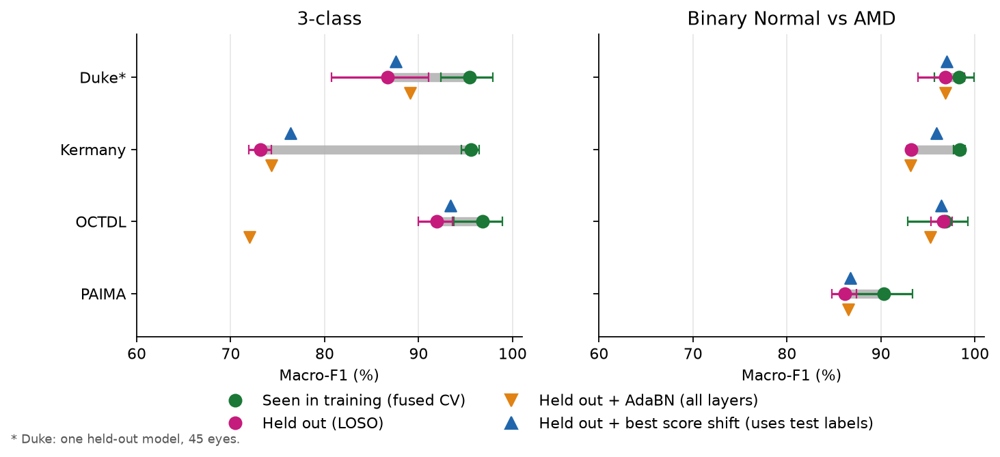
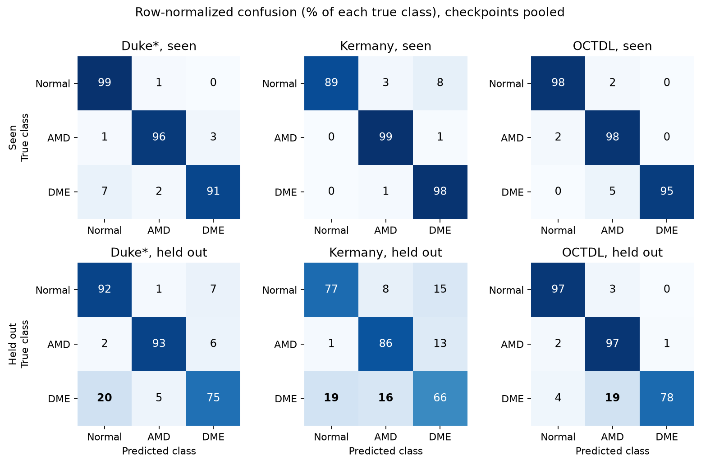
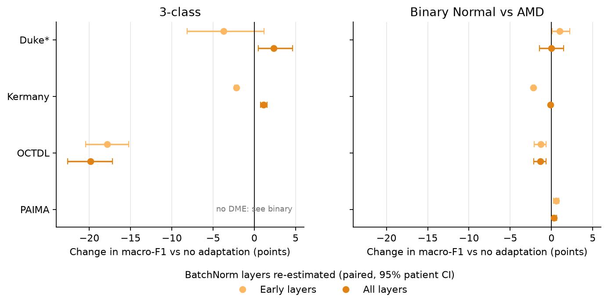
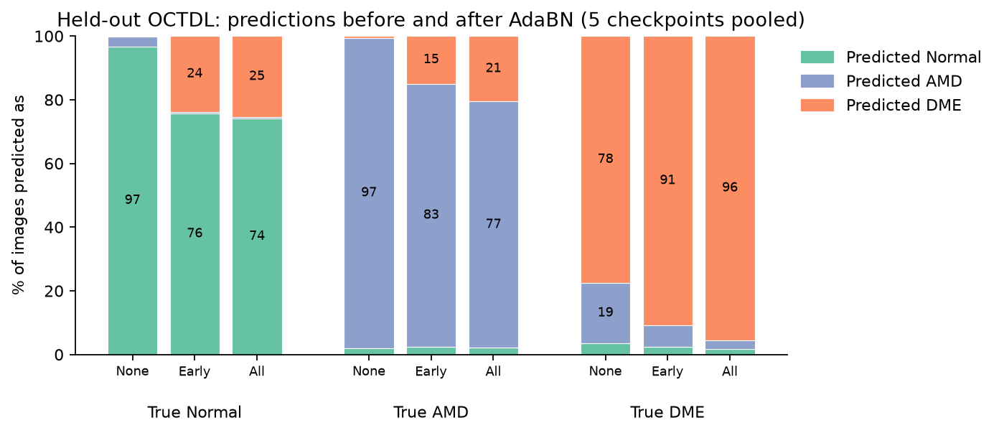
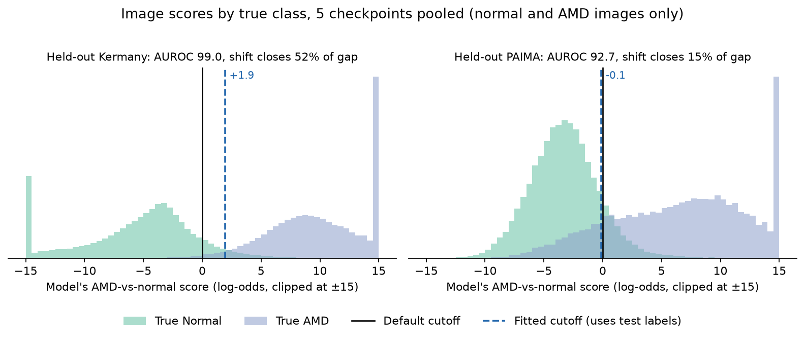

# Daily Report: Cross-Device Investigation (2026-10-04)

Plan: [cross-device-plan.md](../cross-device-plan.md). Today's detailed reports:
[binary rescoring](20261004-binary-rescore.md), [AdaBN](20261004-adabn.md),
[logit bias](20261004-logit-bias.md).

## The Problem in One Paragraph

Our ResNet-50 classifies retinal OCT scans as normal, AMD, or DME. When the test images come from a
device (dataset) the model was trained on, it scores 96–100 macro-F1. When we hold a whole device out of
training and test on it ("leave-one-source-out", LOSO), the score drops, most sharply on Kermany
(95.6 down to 73.2). We want to know why, and what fixes it.

## Where We Stand Now

**The drop is mostly about DME, and it lives in what the model has learned, not in how its outputs are
cut off.** Three cheap experiments, none of which needed retraining, all point the same way:

- If we ignore DME and only ask "normal or AMD?", most of the drop disappears for Kermany, OCTDL and
  Duke.
- Quick fixes applied after training (re-tuning normalization layers, shifting the decision cutoff)
  do not bring DME back. Even a cutoff tuned with the answers in hand only lifts held-out Kermany from
  73 to 76.
- PAIMA is the odd one out. It has no DME at all and still drops (90.3 to 86.2 on normal vs AMD).
  There the model genuinely ranks images worse on the new device, so PAIMA is our cleanest test for the
  training changes to come.

**Next step:** experiment 4 (is it just less training data?), then experiment 3 (augmentation that
mimics device differences).

*How to read it:* each grey bar is the gap for one device: green is the score when the device was in
training, pink when it was held out. A fix that worked would land near green. In 3-class, neither fix gets
close. The orange AdaBN marker for OCTDL even falls far below the starting point. The blue "best score
shift" is fitted with the test labels, so it is a ceiling, not something we could deploy. Its 3-class
value comes from a direct macro-F1 grid search.

## What We Did Today

| # | Experiment | What we did | What we found |
|---|---|---|---|
| 1 | Binary rescoring | Re-scored saved predictions as normal-vs-AMD only, dropping DME | Most of the gap is DME. Kermany: gap shrinks from 22 points to 5. OCTDL and Duke: almost no gap left. PAIMA still drops. |
| 2 | AdaBN | Let the model re-learn its internal brightness/contrast statistics from the new device's images (no labels) | Does not help. Kermany +1, PAIMA under +1, OCTDL **−20** (pushes everything toward DME). Dropped. |
| 7 | Logit bias | Shifted each class's score by a fixed amount per device, fitted using the true labels (a best case, not a usable method) | Fixes only small parts. 3-class: Kermany 73 to 76 at best. Binary: closes half of Kermany's normal-vs-AMD gap, only 15% of PAIMA's. |

Each experiment reused the saved predictions or checkpoints of the 16 existing LOSO models, so no model
was retrained. Every figure pools the 5 checkpoints per held-out device instead of showing runs one by
one.

### Experiment 1: Where the Errors Go

- On a seen device, almost everything sits on the diagonal. On a held-out device, the **DME row** breaks
  (bold cells). The direction depends on the device: Duke's DME goes to normal (20%), OCTDL's goes to AMD
  (19%), and Kermany's splits both ways (19% and 16%).
- Held-out Kermany also has the opposite error: 15% of normal and 13% of AMD images are called DME.
  The model doesn't know where DME starts on this device.
- Even on seen Kermany, 8% of normals are called DME, so the Kermany normal/DME border is shaky to
  begin with.

### Experiment 2: AdaBN

Each dot is the change from AdaBN on the same images, with a 95% interval. Apart from OCTDL in 3-class,
everything sits within a couple of points of zero.

This shows *why* OCTDL gets worse: after AdaBN, about a quarter of normal images and a fifth of AMD
images are called DME. DME recall goes up (78 to 96), but it costs far more than it gains.

**Sanity check that the code is right.** We took a model and scored it on Kermany, a device it *was*
trained on, so there is no device shift to fix:

| Statistics used | Macro-F1 |
|---|---:|
| None (normal evaluation) | 97.6 |
| Re-estimated on Kermany alone | 91.6 |
| Re-estimated on a balanced mix of its 3 training devices | 95.3 |

Re-estimating from the right mix mostly restores the score, so the code works. Re-estimating from one
device alone costs 6 points even with no shift. These models learned their statistics from mixed
batches, which is why AdaBN on a single new device hurts them.

### Experiment 7: Cutoff Problem vs Ranking Problem

- **Kermany (left):** normal and AMD images form two well-separated humps. The model *ranks* them
  correctly (AUROC 99.0), but the default cutoff at 0 cuts into the normal tail. Moving the cutoff to
  +1.9 recovers most of those normals. This is the half of the Kermany gap a cutoff can fix.
- **PAIMA (right):** the humps overlap heavily around 0, and the fitted cutoff barely moves (−0.1).
  No cutoff can separate images the model mixes up, so PAIMA needs better features, not recalibration.

## What We Can Rule Out

| Possible cause | Ruled out? | Why |
|---|---|---|
| Brightness/contrast statistics differ between devices, and re-measuring them fixes it | Yes, as a quick fix | AdaBN barely helps and badly hurts OCTDL. Our models were trained on mixed batches, so statistics from one device alone don't fit them. |
| The model's cutoff or class balance is just set wrong for each device | Yes, for 3-class | Even a best-case cutoff fitted on the answers barely moves 3-class scores. |
| Labels or class proportions differ between devices | Yes, as the main cause | Same evidence as above. A shift in class proportions would be fixed by a per-device bias, and it isn't. |
| Checkpoint selection favouring small datasets | Yes | Already fixed (`f6d1315`) before these runs. |

**Not ruled out:**

- The model's learned DME features don't carry over to new devices (now the leading explanation).
- Held-out Kermany simply leaves too little DME training data (only 122 DME patients remain).
- About half of Kermany's normal-vs-AMD drop *is* a cutoff shift. This is real but small, and it is not
  the main problem.

## What Each Remaining Experiment Tests

| # | Experiment | The question it answers | How to read the result |
|---|---|---|---|
| 4 | **Data-volume control** (next). Train on all devices but cut Kermany's DME down to about 120 patients (or use 50% of the data). | Is the Kermany drop really about a new device, or just about having much less DME to learn from? | If the score falls a lot even with Kermany *seen*, the drop is mostly a data shortage. If it barely moves, the device itself is the problem. |
| 3 | **Device-style augmentation.** Add speckle noise, gamma/contrast changes, blur, and random padding/cropping during training. 4 LOSO runs. | Does showing the model more varied-looking images make it robust to a new device? | Judged mainly on PAIMA (the cleanest test) and on DME recall for held-out devices. |
| 5 | **OCT-specific pretraining.** Start from an OCT foundation model, or pretrain (MAE) on images that include the held-out device, without its labels. | Does a model that has already "seen" lots of OCT, or the new device, learn features that transfer better? | Gains on PAIMA and held-out DME would point to the features as the fix. Larger cost: pretraining plus LOSO. |
| 6 | **Binary runs matching the papers** (optional). Train normal-vs-AMD ResNet-50s Kermany↔Duke, and binary LOSO. | How do our numbers compare with published cross-dataset results (OCT-SelfNet)? | For context only. It doesn't explain the gap. Optional because experiment 1 already answers most of this. |

## Things to Keep in Mind

- **Duke is small** (45 eyes, one held-out model). Treat Duke numbers as supporting, never deciding.
- **Experiments 2 and 7 used the new device's images** (and experiment 7 its labels), so they are
  diagnostics, not results we could deploy.
- **PAIMA labels each B-scan separately**, while Duke labels whole eyes. A PAIMA "normal" slice can come
  from an eye with AMD, which may explain part of PAIMA's drop.
- Confidence intervals resample patients, not training runs, so they don't capture run-to-run noise.

Figures: `uv run --with matplotlib python .scratchpad/9baff02_report-figures/make_figures.py`.
